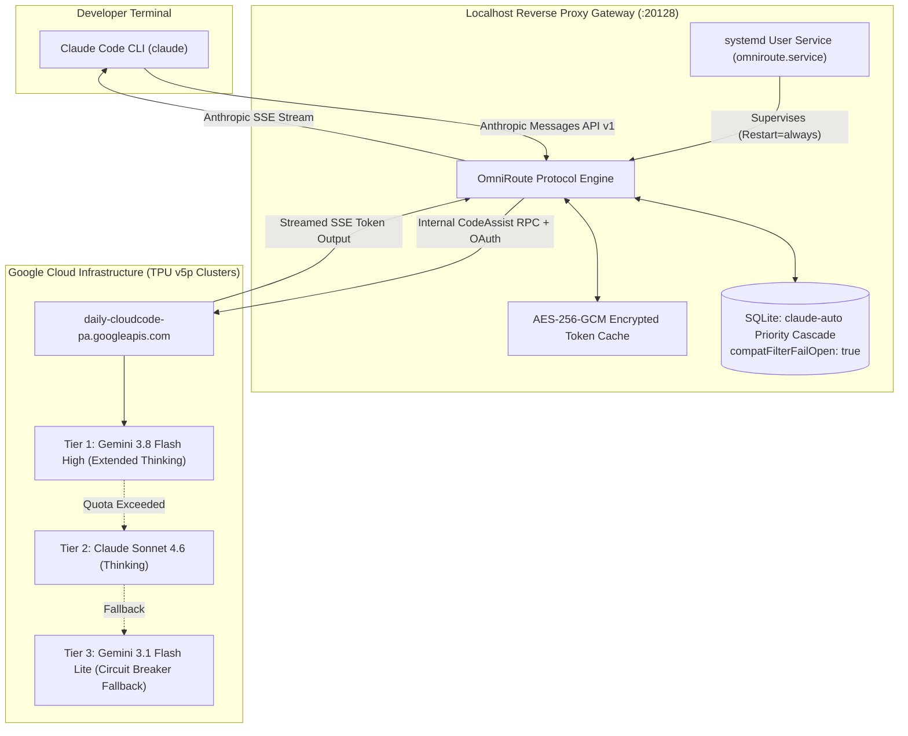

# cc-agy ⚡

> **Decoupled Asymmetric Compute Gateway: Claude Code + Google Antigravity**  
> *Run Anthropic's Claude Code agentic loop powered by Google's frontier Gemini 3.8 Flash (High Reasoning) and Claude Sonnet TPU compute at zero marginal token cost.*

---

## 🏛️ Architecture Overview

`cc-agy` bridges the **Claude Code developer interface** with **Google's Antigravity Cloud Code compute clusters** via an autonomous, systemd-supervised local reverse proxy (`OmniRoute`).



---

## 💡 The Core Problem Solved

| Problem | Standard Setup Failure | `cc-agy` Production Solution |
| :--- | :--- | :--- |
| **API Cost** | Claude Code on Anthropic API burns $15–$50 per day | Bypassed. Consumes Google Antigravity developer quota at **$0 / zero marginal cost**. |
| **Schema Rejection** | `400 No target in combo supports structured output` | Patches SQLite with `compatFilterFailOpen: true`, allowing tool definitions to flow cleanly. |
| **Outage / Reboot Loss** | Terminal-run proxies die on logout, crash, or reboot | Deploys a hardened `systemd --user` service with `Restart=always` (<3s resurrect). |
| **Token Expiration** | Google OAuth tokens expire after 60 minutes | Automatically rotates tokens using the encrypted `refresh_token` stored in local SQLite. |
| **Model Degradation** | Default setups trap the user on low-tier Flash Lite | Structures the priority cascade to lock in **Gemini 3.8 Flash (High Reasoning)** as primary. |
| **Native Binary Bug** | `Error: claude native binary not installed` | Pre-installs `@anthropic-ai/claude-code-linux-x64` and triggers `install.cjs`. |

---

## ⚡ Quick Start

### Prerequisites
1. **Linux** (x86_64 or aarch64) with `systemd`, `node` (>=18), `npm`, and `python3`.
2. **Google Antigravity CLI (`agy`)**: Authenticated with your Google account:
   ```bash
   agy
   ```
   *(Verify `~/.gemini/antigravity-cli/antigravity-oauth-token` exists).*

### 1-Line Bootstrap
```bash
git clone https://github.com/farhatkoka/cc-agy.git
cd cc-agy
./install.sh
```

The bootstrap script will automatically:
1. Verify host dependencies and native binary compatibility.
2. Encrypt and provision your Antigravity credentials into local storage.
3. Patch SQLite combo cascades (`compatFilterFailOpen` & Gemini 3.8 Flash High priority).
4. Deploy and start `omniroute.service` via `systemctl --user`.
5. Sync `~/.claude/settings.json` and shell environment variables.

---

## 🔬 Live Verification

Test a non-interactive tool call through Claude Code:
```bash
claude -p "Check the kernel version using uname -r and report."
```

Inspect the live gateway service status:
```bash
systemctl --user status omniroute
```

Check the health endpoint:
```bash
curl -s http://localhost:20128/api/monitoring/health
```

---

## 🎯 Model Cascading & Fallback Hierarchy

The `claude-auto` combo is tuned for maximum agentic power:

1. **Tier 1 (Primary Brain):** `agy/gemini-3.8-flash-high`  
   *3.7s – 4.9s latency, deep test-time compute (extended thinking), 1M context window, high quota limit.*
2. **Tier 2 (Agentic Fallover):** `agy/claude-sonnet-4-6`  
   *Anthropic's flagship coding architecture, engaged if Gemini hits temporary latency spikes.*
3. **Tier 3 (Zero-Downtime Fallback):** `agy/gemini-3.1-flash-lite`  
   *Engaged only as a circuit breaker if upstream tiers hit short cooling periods.*

---

## 🧹 Uninstallation

To restore your original Claude Code settings, disable the systemd daemon, and clean shell exports:
```bash
./uninstall.sh
```

---

## 🛡️ Security & Zero-Leakage Architecture

- **No Hardcoded Credentials:** `cc-agy` scripts never commit, store, or transmit API keys or OAuth tokens. Tokens are encrypted locally on your own workstation via AES-256-GCM using a host-generated key in `~/.omniroute/.env`.
- **Local Loopback Only:** OmniRoute binds strictly to `127.0.0.1:20128` — never exposed to external network interfaces.

---

## 📄 License

MIT © [Farhat Iqbal](https://github.com/farhatkoka)
