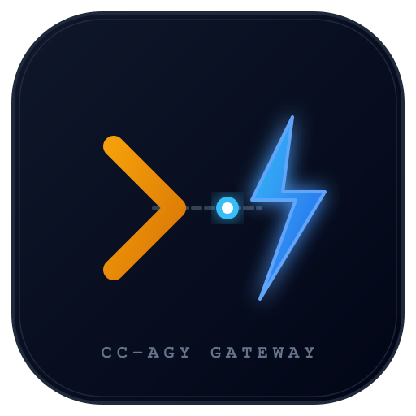
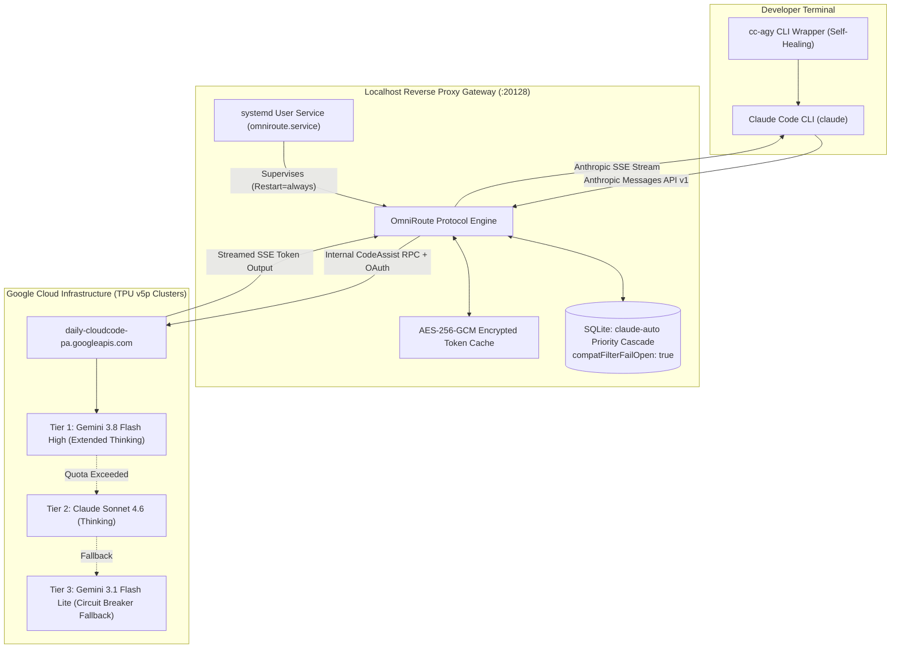

<p align="center">
  
</p>

# cc-agy

> Decoupled Asymmetric Compute Gateway: Claude Code + Google Antigravity  
> Run the Anthropic Claude Code agentic loop powered by Google Cloud Code TPU clusters (Gemini 3.8 Flash High Reasoning and Claude Sonnet 4.6) at zero marginal token cost.

---

## Architecture Overview

`cc-agy` bridges the **Claude Code developer interface** with **Google Cloud Code Antigravity compute clusters** via a local, systemd-supervised reverse proxy (`OmniRoute`).



---

## Technical Problem Register

| Runtime Issue | Standard Failure | cc-agy Production Solution |
| :--- | :--- | :--- |
| **API Cost** | Claude Code on Anthropic API costs $15 to $50 daily | Routes through local reverse proxy into authorized Google Antigravity quota at $0 marginal cost. |
| **Schema Rejection** | 400 error: target combo lacks structured output support | Patches SQLite combo with `compatFilterFailOpen: true` to forward tool definitions cleanly. |
| **Outage / Reboot Loss** | Terminal-run proxies terminate on logout or reboot | Deploys a hardened `systemd --user` service with `Restart=always` and sub-3s auto-resurrect. |
| **Token Expiration** | Google OAuth tokens expire after 60 minutes | Rotates tokens automatically using the encrypted refresh token stored in local SQLite. |
| **Model Degradation** | Default proxy configurations route to Flash Lite | Enforces priority cascade with Gemini 3.8 Flash High Reasoning as primary target. |
| **Native Binary Bug** | Error: claude native binary not installed post-update | `cc-agy` wrapper runs pre-flight ABI checks and links missing native ELF binaries automatically. |

---

## Quick Start

### Prerequisites
1. **Linux** (Arch Linux, Ubuntu, Debian, Fedora) with `systemd`, `node` (>=18), `npm`, and `python3`.
2. **Google Antigravity CLI (`agy`)**: Authenticated with your Google account:
   ```bash
   agy
   ```
   *(Verify that `~/.gemini/antigravity-cli/antigravity-oauth-token` exists).*

### 1-Line Remote Bootstrap (Recommended)
```bash
curl -fsSL https://raw.githubusercontent.com/farhatkoka/cc-agy/main/install.sh | bash
```

### Alternative: NPX Bootstrap
```bash
npx cc-agy
```

### Alternative: Manual Git Clone
```bash
git clone https://github.com/farhatkoka/cc-agy.git
cd cc-agy
./install.sh
```

The bootstrap installer handles setup automatically:
1. Validates host dependencies and Google OAuth tokens.
2. Verifies Claude Code and restores platform-native Linux binaries.
3. Encrypts local Google tokens into OmniRoute SQLite using AES-256-GCM.
4. Patches model cascade priority and enables fail-open schema filtering.
5. Deploys and starts the `omniroute.service` systemd user daemon.
6. Installs the self-healing `cc-agy` CLI binary to `~/.local/bin/cc-agy`.

---

## CLI Usage

Once installed, execute `cc-agy` from any terminal session:

```bash
# Launch interactive Claude Code session
cc-agy

# Autonomous execution (bypasses permission prompts)
cc-agy --dangerously-skip-permissions

# Non-interactive / pipe execution
cc-agy -p "Scan src/ for potential race conditions"

# System diagnostics and telemetry
cc-agy doctor

# Restart local proxy gateway
cc-agy restart
```

---

## Model Routing Hierarchy

The `claude-auto` combo routes requests through this hierarchy:

1. **Tier 1 (Primary):** `agy/gemini-3.8-flash-high`  
   *3.7s to 4.9s latency, extended thinking, 1M token context window.*
2. **Tier 2 (Fallback):** `agy/claude-sonnet-4-6`  
   *Anthropic agentic model hosted on Google TPU backend.*
3. **Tier 3 (Circuit Breaker):** `agy/gemini-3.1-flash-lite`  
   *Sub-second fallback preventing session interruption during upstream rate windows.*

---

## Security Architecture

- **Zero Credential Persistence:** The repository contains executable code only. No tokens, passwords, or personal credentials exist in the codebase.
- **Client-Side Encryption:** Credentials are encrypted on the local host using AES-256-GCM. Storage encryption keys are generated randomly per machine (`secrets.token_hex(32)`) and stored in `~/.omniroute/.env`.
- **Localhost Loopback Only:** OmniRoute binds strictly to `127.0.0.1:20128`. No inbound external network connections are accepted.

---

## Uninstallation

To restore original Claude Code settings, disable the systemd daemon, and remove binaries:
```bash
./uninstall.sh
```

---

## License

MIT (c) Farhat Iqbal
