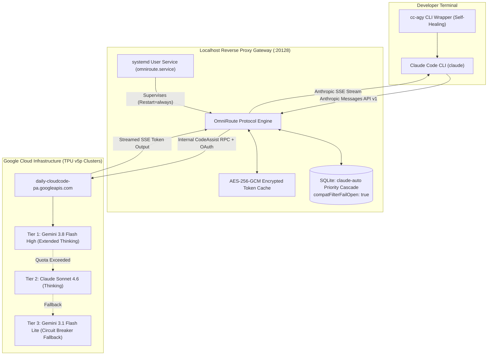

# cc-agy ⚡

> **Decoupled Asymmetric Compute Gateway: Claude Code + Google Antigravity**  
> *Run Anthropic's Claude Code agentic loop powered by Google's frontier Gemini 3.8 Flash (High Reasoning) and Claude Sonnet TPU compute at zero marginal token cost.*

---

## 🏛️ Architecture Overview

`cc-agy` bridges the **Claude Code developer interface** with **Google's Antigravity Cloud Code compute clusters** via an autonomous, systemd-supervised local reverse proxy (`OmniRoute`).



---

## 💡 The Core Problem Solved

| Problem | Standard Setup Failure | `cc-agy` Production Solution |
| :--- | :--- | :--- |
| **API Cost** | Claude Code on Anthropic API burns $15–$50 per day | Bypassed. Consumes Google Antigravity developer quota at **$0 / zero marginal cost**. |
| **Schema Rejection** | `400 No target in combo supports structured output` | Patches SQLite with `compatFilterFailOpen: true`, allowing tool definitions to flow cleanly. |
| **Outage / Reboot Loss** | Terminal-run proxies die on logout, crash, or reboot | Deploys a hardened `systemd --user` service with `Restart=always` (<3s resurrect). |
| **Token Expiration** | Google OAuth tokens expire after 60 minutes | Automatically rotates tokens using the encrypted `refresh_token` stored in local SQLite. |
| **Model Degradation** | Default setups trap the user on low-tier Flash Lite | Structures the priority cascade to lock in **Gemini 3.8 Flash (High Reasoning)** as primary. |
| **Native Binary Bug** | `Error: claude native binary not installed` post-update | Dedicated `cc-agy` wrapper executes autonomous pre-flight ABI checks and self-heals unlinked binaries. |

---

## ⚡ Quick Start

### Prerequisites
1. **Linux** (Arch, Ubuntu/Debian, Fedora) with `systemd`, `node` (>=18), `npm`, and `python3`.
2. **Google Antigravity CLI (`agy`)**: Authenticated with your Google account:
   ```bash
   agy
   ```
   *(Verify `~/.gemini/antigravity-cli/antigravity-oauth-token` exists).*

### 1-Command Bootstrap via NPX
```bash
npx cc-agy
```
*Or install globally:*
```bash
npm install -g cc-agy
cc-agy
```

### Alternative: Git Clone Bootstrap
```bash
git clone https://github.com/farhatkoka/cc-agy.git
cd cc-agy
./install.sh
```

The installer will automatically:
1. Verify host dependencies and Antigravity OAuth tokens.
2. Install Claude Code and heal platform-native Linux binaries.
3. Encrypt and provision your local Antigravity credentials into SQLite.
4. Patch model cascade (`compatFilterFailOpen` & Gemini 3.8 Flash High priority).
5. Deploy and start `omniroute.service` via `systemctl --user`.
6. Install the self-healing `cc-agy` CLI into `~/.local/bin/cc-agy`.

---

## 🕹️ CLI Usage & Subcommands

Once installed, use `cc-agy` directly from any terminal window:

```bash
# Launch interactive Claude Code session
cc-agy

# Bypass confirmation prompts (autonomous execution)
cc-agy --dangerously-skip-permissions

# Run non-interactive prompt / pipes
cc-agy -p "Review src/index.ts for race conditions"

# Run system diagnostic telemetry & health check
cc-agy doctor

# Restart local gateway daemon
cc-agy restart
```

---

## 🎯 Model Cascading & Fallback Hierarchy

The `claude-auto` combo is tuned for maximum agentic power:

1. **Tier 1 (Primary Brain):** `agy/gemini-3.8-flash-high`  
   *3.7s – 4.9s latency, deep test-time compute (extended thinking), 1M context window, high quota limit.*
2. **Tier 2 (Agentic Fallover):** `agy/claude-sonnet-4-6`  
   *Anthropic's flagship coding architecture, engaged if Gemini hits temporary latency spikes.*
3. **Tier 3 (Zero-Downtime Fallback):** `agy/gemini-3.1-flash-lite`  
   *Engaged only as a circuit breaker if upstream tiers hit short cooling periods.*

---

## 🧹 Uninstallation

To restore original Claude Code settings, disable the systemd daemon, and clean binaries:
```bash
./uninstall.sh
```

---

## 🛡️ Security & Zero-Leakage Guarantee

- **Zero Credential Storage:** The package contains **executable logic only**. Exactly 0 bytes of tokens, keys, or personal identifiers are committed to Git or published to npm.
- **Client-Side Encryption:** When executed, `cc-agy` discovers your *own* local Google token (`~/.gemini/.../antigravity-oauth-token`), generates a fresh random 256-bit encryption key on *your* machine, and encrypts credentials via AES-256-GCM.
- **Loopback Enforcement:** OmniRoute binds strictly to `127.0.0.1:20128` — completely inaccessible from the outside network.

---

## 📄 License

MIT © [Farhat Iqbal](https://github.com/farhatkoka)
